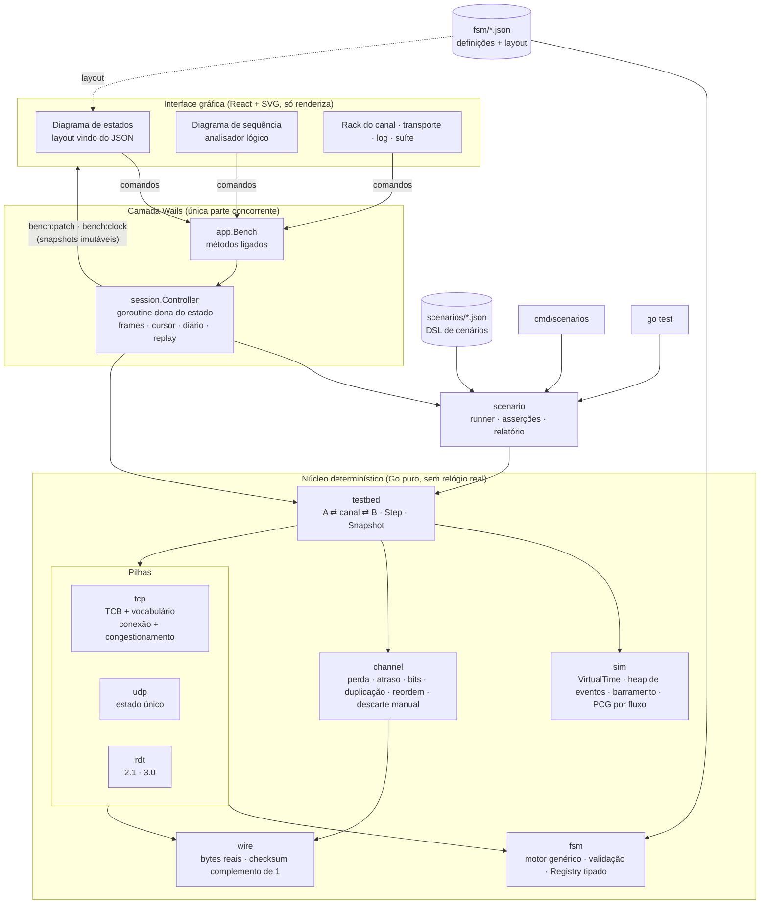
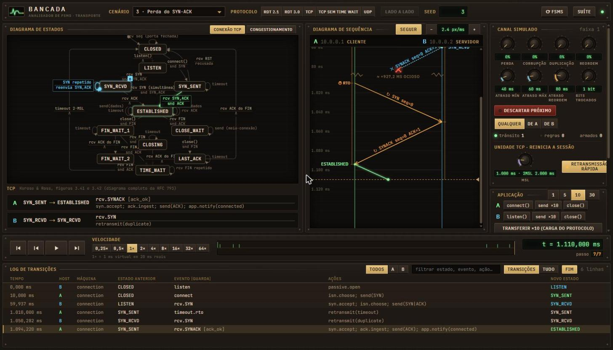
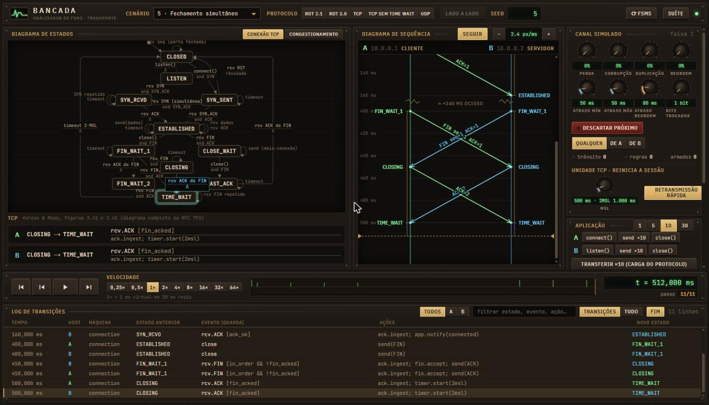
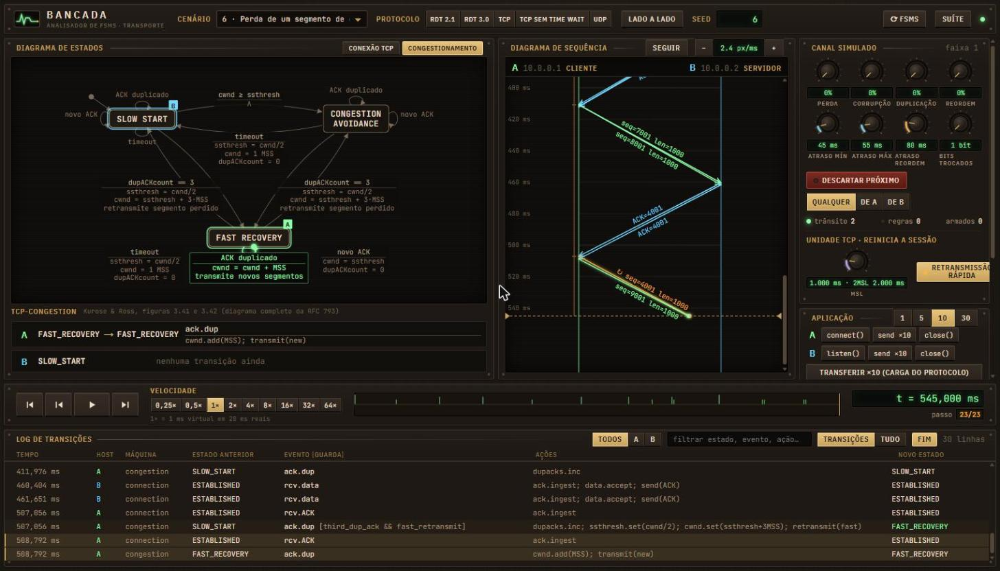

# Bancada: execução, visualização e teste das FSMs do UDP e do TCP

**Redes Convergentes · Unidade 2 · Trabalho Prático 2**
Aluno(a): ______________________ Matrícula: ____________ Data: ___/___/______

> Rascunho gerado junto com o código. Os números das seções 5 e 6 saem de `go run ./cmd/scenarios` (arquivo `report/scenarios.md`) e são reproduzíveis com as seeds indicadas. Os espaços marcados com **[CAPTURA]** recebem as telas da janela desktop. As imagens em `docs/capturas/` são do mesmo app aberto no navegador pelo `wails dev`.

## 1. Objetivo e visão geral

A Bancada é uma aplicação desktop (Go + Wails v2 + React/SVG) que roda as FSMs do capítulo 3 sobre um canal simulado com perda, atraso, corrupção de bits, duplicação e reordenação. A mesma simulação aparece de três formas:

- na **GUI**: diagrama de estados animado, diagrama de sequência no estilo de analisador lógico, controles de canal e de tempo;
- na **CLI** `go run ./cmd/scenarios`;
- no **`go test ./...`**.

As três consomem os mesmos 14 cenários declarados em JSON e verificam automaticamente se cada FSM se comporta como o livro prevê. Na entrega, todos os 14 foram aprovados.

## 2. Arquitetura



### Diferenças em relação à Figura 1 do enunciado e por quê

1. **Uma camada de sessão entre o núcleo e a GUI.** A Figura 1 liga a interface direto ao núcleo. Aqui existe o `session.Controller`, que guarda a linha do tempo de *frames* (snapshot imutável + registros do passo) e um **diário de comandos**. "Voltar um passo" vira mover o cursor. "Aplicar um comando no passado" vira refazer a simulação a partir da seed até aquele passo e descartar o futuro. É event sourcing de verdade, e é o que permite o passo para trás, o scrubber e o clique numa linha do log. A sessão também é o **único ponto concorrente**: uma goroutine dona do estado recebe pedidos por canal, de modo que o núcleo permanece single-threaded.
2. **O barramento de eventos faz mais do que log e replay.** Ele alimenta as estatísticas (que são uma dobra dos registros), os gatilhos dos cenários ("quando B entrar em CLOSE_WAIT, feche 30 ms depois") e as asserções.
3. **O host TCP tem duas FSMs.** A Figura 1 sugere "Motor FSM e buffers" por host. No TCP rodam duas máquinas do livro em paralelo: conexão (figs. 3.41/3.42 completadas pela RFC 793) e congestionamento (fig. 3.51). A retransmissão rápida é uma transição da segunda.
4. **Bytes reais e uma camada `wire`.** O canal transporta bytes codificados com cabeçalhos UDP, TCP e rdt reais, e a corrupção troca bits. O checksum é calculado e verificado de verdade, sem flag de "corrompido" passada ao receptor.
5. **As definições também descrevem o desenho.** Os JSON trazem a posição dos estados e dos rótulos, então o diagrama da GUI é gerado a partir da mesma fonte que o motor executa.
6. **Runner compartilhado.** A mesma DSL e o mesmo runner atendem a CLI, os testes e a suíte dentro da GUI.

## 3. Motor de FSM dirigido por dados

Cada transição do JSON é `(estado, evento, guarda?) → (ações[], novo estado)`, com o rótulo no formato do livro (evento acima da linha, ação abaixo):

```json
{ "from": "FIN_WAIT_1", "event": "rcv.FIN", "guard": "in_order && !fin_acked",
  "actions": ["ack.ingest", "fin.accept", "send(ACK)"], "to": "CLOSING",
  "label": { "event": "rcv FIN", "action": "snd ACK" } }
```

Guardas e ações são resolvidas num `fsm.Registry[C]` genérico e tipado. O carregamento rejeita, com erros tipados (`errors.Is`/`errors.As`), estados inexistentes, guardas e ações não registradas, argumentos não permitidos, transições duplicadas e **inalcançáveis**. Um evento sem transição no estado atual devolve `*fsm.RejectionError` e entra no log com o motivo.

A extensibilidade foi demonstrada de três formas:

- o `rdt-2.1.json` roda sobre o mesmo canal (cenário 12);
- o `rdt-3.0.json` foi escrito **sem nenhuma linha de Go**, reaproveitando o vocabulário `make_pkt`/`udt_send`/`start_timer` (cenário 13);
- o `tcp-sem-time-wait.json` remove um estado do TCP só no JSON (cenário 11).

O botão **⟳ FSMs** da GUI relê os arquivos do disco sem recompilar.

## 4. Implementação

- **Tempo virtual.** O tempo é medido em µs (`type VirtualTime int64`). Um heap ordenado por (tempo, ordem de inserção) é o único relógio. Temporizadores são eventos cancelados no próprio heap, sem `time.Sleep` no núcleo. Os 14 cenários rodam em milissegundos.
- **Determinismo.** Cada fonte aleatória tem um PCG próprio derivado da seed, e o canal sorteia todos os valores para todo pacote. Assim, mudar a perda não muda o atraso do n-ésimo pacote (há teste para isso). A mesma seed reproduz bit a bit o histórico, o que também é testado nos 14 cenários.
- **Checksum.** Soma em complemento de 1 de 16 bits sobre pseudo-cabeçalho, cabeçalho e dados. É conferida contra o exemplo da seção 3.3 e da RFC 1071, e testada com:
  - teste de propriedade (`rapid`): toda troca de 1 bit é detectada em UDP, TCP e rdt;
  - fuzzing nativo (`FuzzChecksum`);
  - um caso que documenta o ponto cego: duas trocas compensadas na mesma coluna passam despercebidas.
- **TCP.**
  - Números de sequência `uint32` com aritmética modular e ACK cumulativo, com buffer de fora de ordem no receptor.
  - EstimatedRTT/DevRTT/TimeoutInterval com α=0,125 e β=0,25 (seção 3.5.3), uma amostra por vez e algoritmo de Karn. O cenário 2 verifica que o SYN retransmitido não gera amostra.
  - Duplicação do intervalo a cada expiração.
  - Retransmissão rápida após 3 ACKs duplicados e Reno completo (slow start, AIMD e fast recovery).
  - RST para porta fechada por um TCB transitório em CLOSED.
  - TIME_WAIT de 2·MSL configurável.
- **Canal.** Perda, atraso uniforme em [mín, máx] com FIFO por sentido, corrupção de 1 a 8 bits, duplicação, reordenação (atraso extra que permite ultrapassagem), "descartar o próximo" e regras do cenário ("descarte o 5º segmento de dados de A").

## 5. Interface gráfica e cenários pedidos

A interface segue a linguagem de um instrumento de bancada:

- **diagrama de estados** com sondas A e B pulsando no estado atual e uma partícula percorrendo a última transição;
- **diagrama de sequência** como captura de analisador lógico: setas inclinadas pelo atraso real, × no meio do canal para perdas, âmbar para retransmissões, traço duplo para duplicatas, serrilhado para corrompidos e compressão de tempo ocioso;
- **rack de knobs** para o canal;
- **transporte de DAW** com passo para trás;
- **log** em que um clique leva àquele instante;
- **modo lado a lado** sincronizado.

**Cenário 3, perda do SYN-ACK** (seed 3).



**[CAPTURA] janela desktop no cenário 3, em t ≈ 1,11 s**

O SYN-ACK original termina no × do meio do canal. O trecho ocioso de ~927 ms aparece comprimido. O RTO de A expira em 1,010 s e o SYN é reenviado (âmbar). B, em SYN_RCVD, recebe o SYN repetido em 1,050 s e reenvia o SYN-ACK (auto-laço "SYN repetido / reenvia SYN,ACK" destacado em ciano). A chega a ESTABLISHED em 1,094 s e B em 1,135 s.

**Cenário 5, fechamento simultâneo** (seed 5).



**[CAPTURA] janela desktop no cenário 5, em t ≈ 512 ms**

Os dois FINs saem em 400 ms e se cruzam (X no diagrama de sequência). Cada lado recebe um FIN cujo ACK ainda não cobre o próprio FIN: a guarda `in_order && !fin_acked` leva a CLOSING. Os ACKs se cruzam e ambos entram em TIME_WAIT em 500 ms, onde ficam exatamente 2·MSL = 1 s (verificação `dwell`).

**Cenário 6, perda de 1 segmento em 10** (seed 6).



**[CAPTURA] janela desktop no cenário 6, aba Congestionamento, em t ≈ 545 ms**

O 5º segmento de dados (seq=4001) se perde em 309 ms. Os segmentos 6, 7 e 8 geram ACK=4001 repetidos. Em 507,056 ms a máquina de congestionamento dispara `ack.dup [third_dup_ack && fast_retransmit]`: SLOW_START → FAST_RECOVERY com `ssthresh = cwnd/2; cwnd = ssthresh + 3·MSS; retransmite`. A retransmissão aparece em âmbar.

## 6. Análise comparativa UDP × TCP (cenário 10)

Mesma carga (30 mensagens de 500 B, intervalo de 10 ms para o UDP), mesmo canal (15% de perda, 5% de corrupção, 5% de duplicação, 10% de reordenação, atraso de 30–70 ms) e mesma seed (17):

| Métrica | UDP | TCP |
|---|---:|---:|
| Mensagens oferecidas | 30 | 30 |
| Entregues (únicas) | **25** | **30** |
| Perdidas para a aplicação | 5 | 0 |
| Duplicadas entregues à aplicação | 2 | 0 |
| Entregues em ordem | 22 | 30 |
| Entregues fora de ordem | 3 | 0 |
| Segmentos enviados | 30 | 46 |
| Retransmissões (rápidas / por timeout) | 0 | 7 (1 / 6) |
| Perdidos no canal | 2 | 5 |
| Corrompidos no canal (descartados pelo checksum) | 3 | 3 |
| Duplicados pelo canal | 2 | 2 |
| Bytes no fio | 15.240 | 21.920 |
| Tempo até a última entrega (desde t = 0) | **361,6 ms** | **2.294,1 ms** |

O canal tratou os dois protocolos de forma estatisticamente igual. A diferença está no que cada transporte faz com as falhas.

- No **UDP**, as 5 mensagens que faltam são exatamente as 2 perdas mais os 3 datagramas que o receptor descartou ao recalcular o checksum, sem avisar ninguém. As 2 cópias criadas pelo canal chegaram à aplicação como mensagens duplicadas, e 3 mensagens chegaram fora de ordem. O UDP é rápido (tudo termina meio RTT depois do último envio) e barato (30 segmentos), mas entrega à aplicação um fluxo com buracos, repetições e desordem.
- No **TCP**, a aplicação recebe as 30 mensagens, uma vez cada, em ordem. As cópias duplicadas foram descartadas pelo número de sequência, os segmentos corrompidos pelo checksum e as perdas recuperadas por 6 timeouts e 1 retransmissão rápida. O custo foi:
  - 53% mais segmentos e 44% mais bytes;
  - o handshake;
  - quase **6,3×** o tempo, porque cada timeout custa no mínimo 200 ms (RTO mínimo, dobrando a cada expiração consecutiva) e derruba cwnd para 1 MSS. O caminho de congestionamento de A foi SLOW_START → FAST_RECOVERY → CONGESTION_AVOIDANCE → SLOW_START → … .

Para quem precisa de **cada** byte em ordem (arquivo, página, comando), o TCP paga o preço sozinho. Para quem prefere chegar **a tempo** a chegar completo (voz, vídeo, jogo, DNS), o UDP deixa a política na mão da aplicação.

## 7. Respostas às perguntas

**1. Por que o estado TIME_WAIT existe, e o que acontece se ele for removido no cenário 4?**
TIME_WAIT mantém o TCB de quem fechou primeiro por 2·MSL depois de enviar o último ACK, por duas razões:

1. **Encerramento confiável.** Se esse ACK se perder, o par em LAST_ACK reenviará o FIN, e alguém precisa estar lá para reconfirmá-lo.
2. **Segmentos atrasados.** Segmentos antigos da conexão (que podem vagar até MSL na rede) morrem antes que o mesmo par de portas seja reutilizado por uma nova conexão, que poderia aceitá-los como dados válidos.

No cenário 4 do jeito que ele é (canal limpo), remover TIME_WAIT não muda nada visível: A iria de FIN_WAIT_2 direto a CLOSED e B fecharia normalmente. O problema só aparece quando a falha acontece. Por isso foi criado o **cenário 11**, que repete o encerramento do cenário 4 perdendo o último ACK de A, em duas execuções com a mesma seed:

- **com TIME_WAIT:** B reenvia o FIN em 690 ms (RTO). A, ainda em TIME_WAIT, recebe-o em 740 ms, reenvia o ACK e **reinicia** o 2·MSL (`TIME_WAIT --rcv.FIN--> TIME_WAIT / snd ACK; timer.restart(2msl)`). B passa de LAST_ACK a CLOSED de forma ordenada em 790 ms.
- **sem TIME_WAIT** (`tcp-sem-time-wait.json`, a mesma FSM menos o estado): A já está em CLOSED em 440 ms. O FIN reenviado encontra uma porta sem conexão, e A responde **RST** em 740 ms (`CLOSED --rcv.FIN--> CLOSED / snd RST`). B sai de LAST_ACK por `rcv.RST`: a aplicação de B recebe **"conexão reiniciada"** em vez de um fechamento normal.

**2. Por que o UDP não precisa de FSM de conexão e quais responsabilidades sobram para a aplicação?**
O UDP não mantém estado entre datagramas: não há handshake, números de sequência, confirmações, janelas ou temporizadores. Cada datagrama é tratado isoladamente, com multiplexação pela porta e verificação do checksum, e por isso a FSM tem um único estado (`READY`) com quatro auto-laços: enviar, entregar, descartar por checksum e descartar por porta sem socket. Os cenários 8, 8b, 9 e 10 mostram o que sobra para a aplicação, quando ela precisar:

- detectar perdas e retransmitir (8 e 10: 5 de 30 perdidas para sempre);
- eliminar duplicatas (8b e 10);
- reordenar (8b e 10);
- controlar fluxo e congestionamento, porque o UDP envia no ritmo que a aplicação mandar, mesmo com a rede saturada;
- definir início e fim de sessão, se precisar;
- reagir a erros silenciosos (9: o datagrama corrompido some sem nenhuma notificação ao remetente).

**3. No cenário 6, quanto tempo a retransmissão rápida economizou em relação ao timeout?**
Medido pela própria simulação (seed 6, atraso de 45–55 ms):

- **no instante da retransmissão:** o terceiro ACK duplicado chega em **507,056 ms**, e o RTO armado no último ACK novo só expiraria em **610,740 ms**. A retransmissão rápida chegou **103,684 ms** antes (métrica `fast_retransmit_saved`; o RTO era de 200 ms, o mínimo, porque o RTT estabilizou perto de 100 ms).
- **de ponta a ponta:** a execução contrafactual `sem-fr` desliga só a guarda `fast_retransmit` e espera o timeout. A transferência das 10 mensagens levou **460,48 ms** com retransmissão rápida e **665,99 ms** sem ela, uma economia de **205,5 ms (−31%)**. A economia total é o dobro da instantânea por causa da recuperação rápida. Com `cwnd = ssthresh + 3·MSS` e a inflação a cada ACK duplicado, o 10º segmento sai durante a recuperação (508,8 ms). Já o timeout reduz cwnd a 1 MSS, e o 10º segmento só pode ser enviado depois do ACK seguinte, quase um RTT mais tarde.

**4. Quais transições do diagrama do livro foram mais difíceis de reproduzir e por quê?**

- **FIN_WAIT_1 ao receber FIN.** O mesmo evento leva a três destinos: CLOSING (FIN puro), TIME_WAIT (FIN que também confirma o nosso FIN, a seta "rcv FIN, ACK" da RFC) e o próprio estado (FIN fora de ordem, que chega antes de dados ainda faltantes). Foi preciso separar por guardas sobre o campo ACK e sobre `rcv_nxt` (`in_order && fin_acked`, `in_order && !fin_acked`, `!in_order`), o que só ficou claro ao construir o fechamento simultâneo e o canal com reordenação.
- **SYN_RCVD recebendo SYN repetido (cenário 3).** O livro não desenha essa seta. Com atrasos simétricos, o SYN reenviado pelo cliente e o RTO do servidor caem no **mesmo instante virtual**. O desempate determinístico do heap resolve a ordem, mas o servidor emitia dois SYN-ACKs. A solução foi tornar a seta explícita (`rcv SYN / reenvia SYN,ACK`), reiniciar o RTO nesse reenvio e escolher uma seed com atraso assimétrico que mostre o caso típico.
- **CLOSED respondendo RST (cenário 7).** No livro, CLOSED é "não existe conexão": não há onde pendurar uma transição. Foi modelado como um TCB transitório que o demultiplexador cria em CLOSED só para processar o segmento, com o auto-laço `rcv seg / snd RST`, que gera RST,ACK com `ack = seq + 1`.
- **Dados dentro da FSM de conexão.** As figuras 3.41/3.42 não mostram a transferência de dados. Ela virou auto-laços em ESTABLISHED, CLOSE_WAIT e FIN_WAIT_*, que delegam a contagem de ACKs duplicados à FSM de congestionamento. Lá, a seta Λ "cwnd ≥ ssthresh" da figura 3.51 precisou virar a guarda `reaches_ssthresh` no evento `ack.new`, porque uma FSM dirigida a eventos não tem transições espontâneas.
- **Definição de ACK duplicado.** A RFC 5681 exige janela anunciada inalterada, mas a rwnd do receptor encolhe justamente quando ele guarda segmentos fora de ordem. Seguida à risca, essa regra impediria a retransmissão rápida do cenário 6. A regra foi relaxada e o motivo, documentado.

## 8. Limitações

Um par de hosts e uma conexão por host; ACK imediato (sem ACK atrasado); sem *zero-window probing*, opções TCP, *timestamps* ou validação de número de sequência do RST; ISN sorteado pela seed em vez de um relógio; checksum UDP obrigatório (como no IPv6). Nenhuma dessas escolhas interfere nos cenários pedidos, e todas estão registradas no README.

## 9. Reprodução

```
go test ./...
go run ./cmd/scenarios                        # tabela + report/scenarios.{json,md}
go run ./cmd/scenarios -trace 11-no-time-wait:sem-tw
wails dev
```
